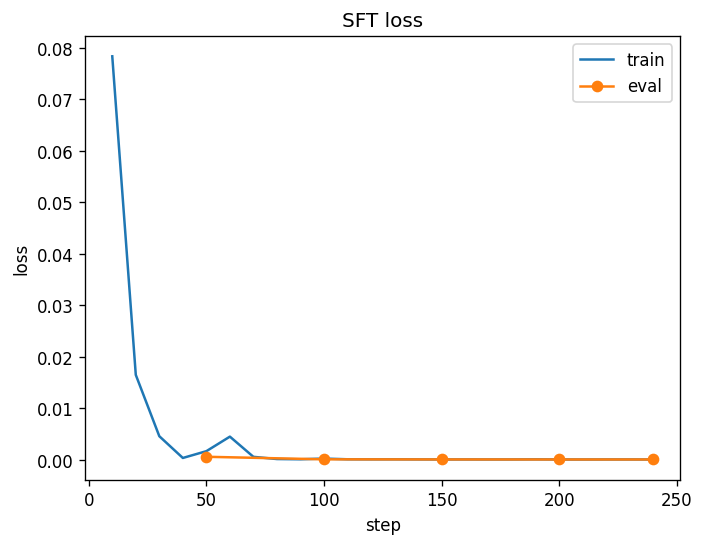

# Hinglish Support Intent — LoRA Fine-tune of Qwen2.5-0.5B

Fine-tunes a small open LLM to read customer-support messages written in **Hinglish, Romanized Hindi or English** and return structured JSON:

```
"mra order OD48213377 kahan pahuncha jaldi"
→ {"intent": "order_status", "order_id": "OD48213377"}
```

Ten intents from e-commerce and banking support (order status, refund, cancellation, failed payment, card block, address change, delivery delay, return, login issue, talk to an agent).

[](https://colab.research.google.com/github/Abhisheklpu1731/hinglish-intent-qlora/blob/main/train_colab.ipynb)

## Demo

A Gradio app (`space/`) runs the fine-tuned model next to the base model on the same message, so the effect of fine-tuning is visible side by side, with CPU latency for each. It runs on a free Hugging Face CPU Space.

**Live demo:** _link added after deployment_

## Results

Held-out test set: 240 messages built from sentence patterns **never seen in training**. Same prompt, same decoding, same script for both rows.

| Model | Intent accuracy | Macro-F1 | Order-ID exact | Labels outside the allowed set |
|---|---|---|---|---|
| Qwen2.5-0.5B-Instruct (zero-shot) | 55.4% | 0.538 | 76.7% | 32 / 240 |
| **+ LoRA SFT (this repo)** | **95.0%** | **0.947** | **100%** | **0 / 240** |

Both models produced valid JSON 100% of the time. Trained in about 15 minutes on a free Colab T4; adapter on the Hub: [`abhikrs41/qwen05-hinglish-intent-lora`](https://huggingface.co/abhikrs41/qwen05-hinglish-intent-lora) (8.8M parameters).



### Error analysis

- **Base model:** made up labels that aren't in the allowed list (`login_failure`, `delivery`, `delivery_status`) 32 times, confused *payment failed* with *refund* 24 times, and often missed order IDs or mangled them (`order_kx354851196`, lowercase IDs).
- **Fine-tuned model:** all 12 remaining errors come from **one** held-out sentence pattern, *"return ho gaya kurta, refund kab aayega"*, predicted as `product_return` instead of `refund_request`. The message mentions both a return and a refund, so it is genuinely ambiguous; the fix is a training pattern for "return done, where's my refund".
- **Caveat:** validation loss falls close to zero because validation shares sentence patterns with training. The held-out test set is the honest measure, and the data is synthetic, so real chat transcripts would be harder.

All predictions are in `results/*_predictions.jsonl`; metrics in `results/*_metrics.json`.

## How it works

**1. Synthetic data** (`data/generate.py`)
- Hand-written templates per intent, mixing Hinglish, Romanized Hindi and English, filled with random order IDs, products, amounts and day counts.
- Noise that real chat text has: spelling variants (`nahi/nhi`, `kya/kia`, `please/pls`), lowercase, dropped punctuation, "urgent/jaldi" suffixes.
- **Leakage control:** ~25% of templates per intent are held out *before* slot filling, so the test set checks new phrasings, not memorised ones. 1,917 train / 213 val / 240 test.

**2. LoRA SFT** (`src/train.py`, TRL `SFTTrainer`)
- **LoRA r=16, alpha=32** on all linear layers (8.8M trainable parameters, 1.7% of the model).
- On the free Colab T4 it trains in full fp32 (`--fp32`). On Ampere GPUs it runs as **QLoRA**: base weights frozen in 4-bit NF4 with double quantisation, bf16 compute.
- Precision handling for older GPUs: the T4 has no real bf16 support, and TRL casts QLoRA adapters to bf16, which breaks fp16 gradient scaling. `train.py` detects the GPU generation and picks a working setup instead of crashing.
- Conversational prompt-completion format with **loss on the completion only**, so the model learns the answer rather than the system prompt.
- 2 epochs, lr 2e-4, cosine schedule. Optional Weights & Biases logging (`--report-to wandb`).

**3. Evaluation** (`src/evaluate.py`)
- Greedy decoding, batched with left padding; LoRA merged into the base weights for inference.
- Metrics: JSON validity, intent accuracy, macro-F1, order-ID exact match, latency per example.
- Same script and test set for base and fine-tuned, so the comparison is like for like.

## Run it

Colab (free T4, ~25 min): open `train_colab.ipynb` and *Run all*.

Locally with a GPU:
```bash
pip install -r requirements.txt
python data/generate.py --out data
python src/evaluate.py --tag base
python src/train.py --out outputs/qwen05-lora
python src/evaluate.py --adapter outputs/qwen05-lora --tag finetuned
pytest tests
```

## Limitations and next steps

- Data is synthetic and template-based; real support transcripts are messier (longer, multi-intent, Devanagari mixed in).
- Next: add a training pattern for the return-then-refund case, a DPO pass on preference pairs, compare LoRA ranks, and try Qwen2.5-1.5B to measure the accuracy/latency trade-off.

## Deploy the demo (free)

1. Run the Colab notebook to the end. Its last cell pushes the LoRA adapter to the Hugging Face Hub (this repo's is [`abhikrs41/qwen05-hinglish-intent-lora`](https://huggingface.co/abhikrs41/qwen05-hinglish-intent-lora)).
2. On huggingface.co: **New Space** → SDK **Gradio** → hardware **CPU basic (free)**.
3. Upload the three files from `space/` (`app.py`, `requirements.txt`, `README.md`).
4. If your adapter repo name differs, set `ADAPTER_ID` under Space → Settings → Variables.

The first start downloads the 0.5B model (~1 GB) and takes a few minutes.

## Structure
```
data/generate.py      synthetic dataset generator
src/common.py         prompt format, output parsing, metrics
src/train.py          LoRA / QLoRA SFT with TRL
src/evaluate.py       base vs fine-tuned evaluation
train_colab.ipynb     end-to-end Colab run
tests/                unit tests for parsing and metrics
space/                Gradio demo for Hugging Face Spaces
```
